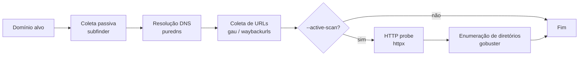

# Rebellion


Ferramenta de reconhecimento (recon) para bug bounty e pentest. Orquestra ferramentas
consagradas do ecossistema ProjectDiscovery e afins para enumerar subdomínios, resolver DNS,
coletar URLs históricas e identificar hosts HTTP ativos, organizando tudo em uma estrutura de
pastas por execução e registrando os resultados em um banco PostgreSQL.

## Índice

- [Sobre](#sobre)
- [Como funciona](#como-funciona)
- [Requisitos](#requisitos)
- [Instalação](#instalação)
- [Banco de dados](#banco-de-dados)
- [Compilação](#compilação)
- [Uso](#uso)
- [Painel web](#painel-web)
- [Saída](#saída)
- [Estrutura do projeto](#estrutura-do-projeto)
- [Desenvolvimento](#desenvolvimento)
- [Solução de problemas](#solução-de-problemas)
- [Aviso legal](#aviso-legal)

## Sobre

O Rebellion centraliza em um único comando as etapas iniciais de um recon:

- **Coleta passiva** de subdomínios com `subfinder`
- **Resolução DNS** com `puredns`
- **Coleta de URLs** com `gau` e `waybackurls`
- **Validação HTTP** (opcional) com `httpx`

Todos os artefatos são gravados em `output/<domínio>/<data_hora>/`, com uma pasta para cada
etapa do pipeline, além dos logs de execução.

O projeto também inclui um **painel web somente leitura** para consultar o que foi gravado no
PostgreSQL, com busca, filtros e uma API JSON.

## Como funciona



> **Status:** o projeto está em desenvolvimento ativo. As etapas de coleta com `subfinder`
> (`BuscarSubfinder`) e resolução com `puredns` (`RunPureDNS`) já estão implementadas, mas
> ainda estão desativadas em `internal/recon/passive-scan.go`. Na versão atual, o scan passivo
> executa apenas a coleta de URLs. O `naabu` ainda não faz parte do fluxo; o `gobuster` roda
> no scan ativo de forma experimental (uma falha nele não interrompe o scan).

## Requisitos

| Requisito | Versão / Observação |
| --- | --- |
| [Go](https://go.dev/dl/) | 1.26.4 ou superior |
| [Docker](https://docs.docker.com/engine/install/) + Compose | Para subir o PostgreSQL |
| `subfinder` | Coleta passiva de subdomínios |
| `puredns` | Resolução DNS em massa |
| `httpx` | Validação de hosts HTTP |
| `gau` | Coleta de URLs de fontes históricas |
| `waybackurls` | Coleta de URLs do Wayback Machine |
| `anew` | Deduplicação usada nos pipelines |
| Lista de resolvers DNS | Arquivo local (`resolved.txt` por padrão) para o `puredns` |

As ferramentas externas precisam estar instaladas e disponíveis no `PATH`, pois o Rebellion
as executa diretamente via `os/exec`.

## Instalação

### 1. Clone o repositório

```bash
git clone https://github.com/m4rco0/Rebellion.git
cd Rebellion
go mod tidy
```

### 2. Instale as ferramentas externas

Ferramentas da ProjectDiscovery:

```bash
go install github.com/projectdiscovery/subfinder/v2/cmd/subfinder@latest
go install github.com/projectdiscovery/httpx/cmd/httpx@latest
```

PureDNS e utilitários de URL:

```bash
go install github.com/d3mondev/puredns/v2@latest
go install github.com/lc/gau/v2/cmd/gau@latest
go install github.com/tomnomnom/waybackurls@latest
go install github.com/tomnomnom/anew@latest
```

Confirme que os comandos estão acessíveis:

```bash
subfinder -version
puredns -h
httpx -version
gau -version
waybackurls -h
anew -h
```

Se algum comando não for encontrado, adicione o diretório de binários do Go ao `PATH`
(preferencialmente no seu `~/.bashrc` ou `~/.zshrc`):

```bash
export PATH="$PATH:$(go env GOPATH)/bin"
```

### 3. Prepare a lista de resolvers

O `puredns` precisa de um arquivo com resolvers DNS válidos. O caminho padrão é
`./resolved.txt` e pode ser alterado com a flag `--resolver`. Crie o arquivo na raiz do projeto:

```bash
# exemplo: um resolver por linha
echo "1.1.1.1" >> resolved.txt
echo "8.8.8.8" >> resolved.txt
```

> O `.gitignore` do projeto ignora arquivos `*.txt`, então essa lista não é versionada —
> cada ambiente precisa da sua.

## Banco de dados

O Rebellion usa PostgreSQL (via GORM) para persistir programas, domínios, scans, subdomínios,
hosts, resoluções, portas, URLs e observações HTTP. A conexão é obrigatória: sem o banco, o
programa encerra na inicialização.

Cada execução cria um registro em `scans` com status `running` e o encerra como `completed` ou
`failed`, guardando o erro quando houver. Mesmo que uma etapa falhe no meio, os artefatos já
gerados são persistidos. As gravações usam upsert, então rodar o mesmo scan mais de uma vez não
duplica subdomínios, URLs ou probes.

| Tabela | Papel |
| --- | --- |
| `programs` | Programa de bug bounty; scans avulsos usam o programa `manual` |
| `domains` | Domínio raiz associado a um programa |
| `scans` | Execução do pipeline (status, início, fim, erro) |
| `subdomains` | Hostnames descobertos, únicos por domínio |
| `scan_subdomains` | Em qual scan e por qual fonte cada subdomínio apareceu |
| `hosts` | Endereços IP resolvidos |
| `resolutions` | Ligação subdomínio → IP em um scan |
| `ports` | Portas abertas por host (para o `naabu` futuro) |
| `urls` | URLs descobertas, com hash para deduplicação |
| `http_probes` | Resultado do `httpx` por scan/URL |

Suba o PostgreSQL e o painel web com Docker Compose:

```bash
make compose-up
```

> Para subir apenas o banco, rode `docker compose up -d db`. O `Makefile` usa o plugin
> `docker compose` (Docker Compose v2).

Crie o arquivo `.env` na raiz do projeto:

```dotenv
DB_HOST=localhost
DB_PORT=5432
DB_USER=root
DB_PASSW=123
DB_NAME=postgresql
DB_SSLMODE=disable

# painel web (opcional)
WEB_PORT=8080
# WEB_USER=admin
# WEB_PASSW=troque-esta-senha
```

`DB_HOST`, `DB_PORT`, `DB_USER`, `DB_NAME` e `DB_SSLMODE` têm defaults
(`localhost`, `5432`, `root`, `postgres`, `disable`), mas os valores precisam ser os mesmos
usados pelo `compose.yml`. As tabelas são criadas automaticamente pelo `AutoMigrate` do GORM
na primeira execução.

> **Atualizando de uma versão antiga:** o schema mudou (por exemplo, `endpoints` virou `urls` e
> `endereco_ip` virou `ip`). O `AutoMigrate` não remove colunas antigas e pode falhar ao adicionar
> colunas `NOT NULL` em tabelas que já têm dados. Se você já usou o projeto antes, recrie o volume:
>
> ```bash
> docker compose down -v   # apaga o volume e os dados
> make compose-up
> ```

Para derrubar o banco:

```bash
make compose-down
```

## Compilação

```bash
go build -o rebellion ./cmd/rebellion
```

Ou execute diretamente, sem gerar binário:

```bash
go run ./cmd/rebellion exemplo.com
```

## Uso

```text
rebellion [opções] <domínio>
```

| Flag | Padrão | Descrição |
| --- | --- | --- |
| `--active-scan` | `false` | Habilita a validação HTTP com `httpx` e a enumeração de diretórios com `gobuster` |
| `--passive-scan` | `false` | Reservado para execução explícita do scan passivo (ainda não altera o fluxo) |
| `--resolver` | `./resolved.txt` | Caminho para o arquivo de resolvers DNS usados pelo `puredns` (aceita `~/`) |
| `--Header` | vazio | Header customizado para identificação em plataformas (ainda não propagado aos scans) |

O domínio alvo é um argumento posicional obrigatório.

### Exemplos

Scan passivo (coleta de URLs):

```bash
./rebellion exemplo.com
```

Scan com validação HTTP:

```bash
./rebellion --active-scan exemplo.com
```

Usando uma lista de resolvers fora da raiz do projeto:

```bash
./rebellion --resolver ~/wordlists/resolvers.txt exemplo.com
```

Ao final, o programa imprime no terminal os caminhos de todos os arquivos gerados.

## Painel web

O painel lê o mesmo PostgreSQL usado pela CLI e serve uma interface somente leitura, sem build
de frontend: templates HTML, CSS e JavaScript são embutidos no binário com `go:embed`.

Para subir o banco e o painel juntos com Docker Compose:

```bash
make compose-up
# equivalente a:
docker compose up -d --build
```

O painel fica em <http://127.0.0.1:8080> e o Compose só publica a porta em localhost. Use
`WEB_PORT` no `.env` para trocar a porta (por exemplo, `WEB_PORT=9090`). Para subir somente o
banco, use `docker compose up -d db`; para acompanhar os logs do painel, `make compose-logs`.

Também é possível rodar o painel direto na máquina:

```bash
make web
# equivalente a:
go run ./cmd/web -addr 127.0.0.1:8080
```

Depois abra <http://127.0.0.1:8080>.

| Página | Rota | Conteúdo |
| --- | --- | --- |
| Visão geral | `/` | Contadores, scans recentes, códigos HTTP e tecnologias |
| Scans | `/scans` | Histórico com filtro por domínio e status |
| Detalhe do scan | `/scans/{id}` | Probes, subdomínios descobertos e resoluções |
| Domínios | `/domains` | Domínios com contagem de subdomínios, URLs e scans |
| Detalhe do domínio | `/domains/{id}` | Scans recentes e subdomínios paginados |
| Subdomínios | `/subdomains` | Busca por nome, com contagem de URLs |
| Detalhe do subdomínio | `/subdomains/{id}` | Resoluções DNS, URLs e probes recentes |
| Grafo | `/graph` | Relação entre domínios e subdomínios, com filtro e limite de nós |
| URLs | `/urls` | URLs descobertas, último status HTTP e número de probes |
| HTTP | `/probes` | Probes com filtro por status, falha e busca textual |

O grafo é desenhado no navegador em SVG, sem bibliotecas externas. Arraste os nós, use a roda do
mouse para ampliar e clique em um nó para abrir os detalhes. Em bancos grandes, o seletor
`Subdomínios por domínio` controla quantos nós são carregados.

### API JSON

As mesmas consultas estão disponíveis em JSON, com paginação (`page`, `page_size`) e os mesmos
filtros das páginas:

| Rota | Filtros |
| --- | --- |
| `/api/stats` | — |
| `/api/scans` | `q`, `status` |
| `/api/domains` | `q` |
| `/api/subdomains` | `q` |
| `/api/graph` | `domain` (ID do domínio) e `limit` (subdomínios por domínio) |
| `/api/urls` | `q` |
| `/api/probes` | `q`, `code`, `failed` (`yes`/`no`) |
| `/healthz` | — (verifica a conexão com o PostgreSQL) |

Exemplo:

```bash
curl 'http://127.0.0.1:8080/api/probes?code=200&page_size=50'
```

Cada resposta tem o formato:

```json
{
  "items": [],
  "page": 1,
  "page_size": 25,
  "total": 0,
  "total_pages": 1
}
```

O `/api/graph` usa outro formato: `nodes` (domínios e subdomínios), `links` (as ligações),
`total`, `shown`, `limit` e `truncated`. Exemplo:

```bash
curl 'http://127.0.0.1:8080/api/graph?domain=1&limit=50'
```

### Configuração

| Variável | Padrão | Descrição |
| --- | --- | --- |
| `WEB_ADDR` | `127.0.0.1:8080` | Endereço de escuta (a flag `-addr` tem precedência) |
| `WEB_PORT` | `8080` | Porta publicada no host pelo Compose |
| `WEB_USER` | vazio | Usuário do HTTP Basic Auth; vazio desativa a autenticação |
| `WEB_PASSW` | vazio | Senha do HTTP Basic Auth |

Por padrão o painel escuta apenas em localhost. Para expor na rede, use `-addr :8080` e configure
`WEB_USER`/`WEB_PASSW` — os dados de recon podem ser sensíveis. No Compose, `/healthz` fica
acessível sem autenticação para servir de healthcheck do container.

Para gerar um binário próprio:

```bash
go build -o rebellion-web ./cmd/web
./rebellion-web -addr 127.0.0.1:8080
```

## Saída

Cada execução cria uma pasta com timestamp:

```text
output/<domínio>/<AAAA-MM-DD_HH-MM-SS>/
```

Estrutura gerada:

```text
output/<domínio>/<data_hora>/
├── 01_passive/
│   └── subdomains_raw.txt      # subdomínios brutos (subfinder)
├── 02_dns/
│   └── resolved.txt            # subdomínios resolvidos (puredns)
├── 03_http/
│   ├── alive.txt               # hosts vivos (derivado do httpx)
│   └── httpx_details.txt       # saída JSON do httpx
├── 04_urls/
│   └── urls.txt                # URLs coletadas (gau/waybackurls)
├── 05_findings/                # reservado para achados
├── logs/                       # logs de cada etapa
└── report.md                   # relatório consolidado (previsto)
```

| Caminho | Conteúdo | Etapa |
| --- | --- | --- |
| `01_passive/subdomains_raw.txt` | Subdomínios brutos encontrados | `subfinder` |
| `02_dns/resolved.txt` | Subdomínios que resolveram | `puredns` |
| `03_http/alive.txt` | Hosts HTTP ativos | derivado de `httpx` |
| `03_http/httpx_details.txt` | JSON com status, título, servidor, IP, CDN etc. | `httpx` |
| `04_urls/urls.txt` | URLs históricas coletadas | `gau` / `waybackurls` |
| `logs/` | Logs por etapa de execução | `runner` |

> Arquivos das etapas ainda desativadas só aparecem quando essas etapas voltarem ao fluxo.
> O `report.md` já está previsto na estrutura, mas ainda não é preenchido.

## Estrutura do projeto

```text
Rebellion/
├── cmd/
│   ├── rebellion/          # CLI de recon (main)
│   └── web/                # servidor do painel (main)
├── internal/
│   ├── cli/                # parsing de flags e argumentos
│   ├── database/           # conexão com PostgreSQL, DSN e models GORM
│   ├── pathing/            # criação da árvore de diretórios por scan
│   ├── recon/              # etapas passivas e ativas do recon
│   ├── runner/             # execução de binários e pipelines com timeout
│   ├── storage/            # parsers das saídas (linhas e httpx JSON)
│   ├── store/              # persistência: upserts, transações e vínculos
│   ├── utils/              # banner e cores do terminal
│   └── web/                # handlers, templates e assets do painel
├── Dockerfile              # imagem do painel web
├── .dockerignore
├── compose.yml             # PostgreSQL + painel web
├── Makefile                # atalhos de desenvolvimento
└── go.mod
```

## Desenvolvimento

```bash
make fmt       # go fmt ./...
make vet       # go vet ./...
make tests     # go test -v ./...
make lint      # gofmt + golint (requer golint instalado)
make web       # sobe o painel em http://127.0.0.1:8080
make web-build # gera o binário rebellion-web
make compose-up    # banco + painel em containers
make compose-build # reconstrói a imagem do painel
make compose-logs  # acompanha os logs do painel
make compose-down  # derruba os containers
```

Para rodar os testes diretamente:

```bash
go test ./...
```

Os testes do pacote `internal/store` são de integração e precisam de um PostgreSQL
descartável. Sem a variável `TEST_DATABASE_URL` eles são ignorados:

```bash
TEST_DATABASE_URL="host=localhost user=root password=123 dbname=rebellion_test port=5432 sslmode=disable" \
  go test ./internal/store -v
```

> Use um banco separado (`rebellion_test`): os testes truncam as tabelas antes de rodar.
> Com o compose no ar, crie o banco com
> `docker compose exec db createdb -U root rebellion_test`.

## Solução de problemas

**`ferramenta não encontrada: <nome>`**

- Confirme que a ferramenta está instalada e no `PATH`.
- Verifique se `$(go env GOPATH)/bin` está exportado no seu shell.

**`Erro ao carregar o arquivo .env`**

- Crie o `.env` na raiz do projeto com as variáveis `DB_*` descritas acima.
- O arquivo deve estar no mesmo diretório de onde o binário é executado.

**Erro ao inicializar o banco de dados**

- Suba o PostgreSQL com `make compose-up` e confira `docker compose ps`.
- Garanta que `DB_HOST`, `DB_PORT`, `DB_USER`, `DB_PASSW` e `DB_NAME` batem com o `compose.yml`.
- Se o binário roda fora do Docker, use `DB_HOST=localhost`.

**Erro de migração (`migrar schema`)**

- O schema mudou em relação a versões anteriores. Recrie o volume com
  `docker compose down -v && make compose-up` (isso apaga os dados existentes).

**`permission denied while trying to connect to the Docker API`**

- Seu usuário não está no grupo `docker`. Rode:

  ```bash
  sudo usermod -aG docker "$USER"
  newgrp docker   # ou encerre a sessão e entre novamente
  ```

- Confirme com `docker ps`. Como alternativa temporária, execute o compose com `sudo`.

**Erro no `puredns`**

- Confirme que o arquivo de resolvers existe (padrão `./resolved.txt`).
- Verifique se o arquivo contém resolvers DNS válidos e acessíveis.

**Nenhum host vivo no scan ativo**

- Confira se `02_dns/resolved.txt` contém domínios resolvidos.
- Tente novamente com outra lista de resolvers ou outro alvo.

**`./Rebellion: No such file or directory`**

- O binário gerado se chama `rebellion` (minúsculo). Compile com
  `go build -o rebellion ./cmd/rebellion` e execute `./rebellion`.

**Painel web não abre ou a porta está em uso**

- Confira se o processo está rodando e se a porta está livre: `ss -ltn | grep 8080`.
- Use outra porta com `go run ./cmd/web -addr 127.0.0.1:9090`.

**Painel responde `401 Unauthorized`**

- `WEB_USER` e `WEB_PASSW` estão definidos no ambiente ou no `.env`. Informe as credenciais no
  navegador ou remova as variáveis para desativar a autenticação (apenas em ambiente local).

## Aviso legal

O Rebellion deve ser usado apenas em alvos para os quais você tem autorização explícita
(escopo de bug bounty, contrato de pentest ou sistemas próprios). O uso contra terceiros sem
permissão pode violar leis e termos de serviço. A responsabilidade pelo uso é inteiramente
do usuário.
